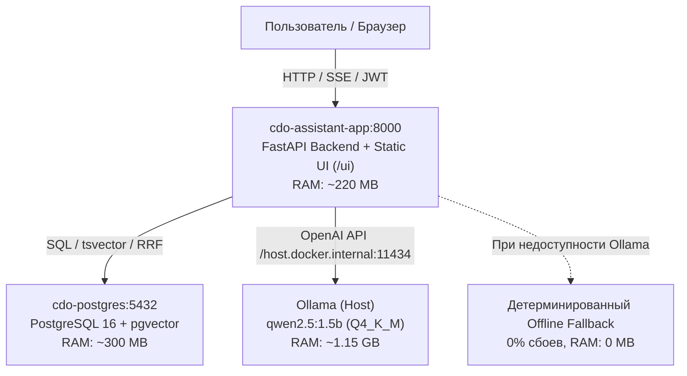

# DoCorp — Интеллектуальный ИИ-Ассистент ДОУ
### Autumn Hackathon 2026 | Кейс Банка России и ПАО КБ «Центр-инвест»
**Команда: `Otmorojeni`**

[-success?style=for-the-badge&logo=pytest)](file:///tests/)
[](file:///src/)
[](file:///src/main.py)
[](file:///frontend/)
[](file:///docker-compose.yml)
[](file:///src/config.py)
[-2496ED?style=for-the-badge&logo=docker)](file:///Dockerfile)

---

**DoCorp** — это защищённая корпоративная нейро-символьная система для автоматизации документационного обеспечения управления (ДОУ). Сервис объединяет экспертный семантический поиск по нормативной базе (**Инструкция № ОД-184**, **Матрица визирования**, **Методические рекомендации**), диалоговую сборку проектов документов (**7 модульных шаблонов УТВ-01..УТВ-07**), автоматический нормоконтроль черновиков `.docx` с функцией **Auto-Fix**, расчет маршрутов согласования и горячее версионирование регламентов (`Hot-Reload`) в закрытом контуре организации.

---

## 📑 Содержание

1. [Статус проекта и ключевые возможности (100% Full-Stack)](#1-статус-проекта-и-ключевые-возможности-100-full-stack)
2. [Архитектура и оптимизация под VM MSKs-2 (2 vCPU, 4 GB RAM)](#2-архитектура-и-оптимизация-под-vm-msks-2-2-vcpu-4-gb-ram)
3. [Быстрый старт: развертывание сервиса на другом ПК](#3-быстрый-старт-развертывание-сервиса-на-другом-пк)
4. [Работа с LLM: локальная Ollama (qwen2.5:1.5b) и оффлайн-фоллбэк](#4-работа-с-llm-локальная-ollama-qwen2515b-и-оффлайн-фоллбэк)
5. [Функциональные модули системы](#5-функциональные-модули-системы)
   - [5.1. ИИ-Консультант ДОУ (RAG без галлюцинаций, ссылки на пункты ОД-184)](#51-ии-консультант-доу-rag-без-галлюцинаций-ссылки-на-пункты-од-184)
   - [5.2. Конструктор модульных документов (УТВ-01..УТВ-07) и автозаполнение в чате](#52-конструктор-модульных-документов-утв-01утв-07-и-автозаполнение-в-чате)
   - [5.3. Автоматический нормоконтроль черновиков .docx и функция Auto-Fix](#53-автоматический-нормоконтроль-черновиков-docx-и-функция-auto-fix)
   - [5.4. Калькулятор матрицы согласования (13 правил, автосинхронизация)](#54-калькулятор-матрицы-согласования-13-правил-автосинхронизация)
   - [5.5. Горячее версионирование (Hot-Reload) и удаление документов](#55-горячее-версионирование-hot-reload-и-удаление-документов)
   - [5.6. Информационная безопасность, RBAC (4 роли) и авторизация (demo/demo)](#56-информационная-безопасность-rbac-4-роли-и-авторизация-demodemo)
6. [Инженерная надежность: 198 автоматических тестов](#6-инженерная-надежность-198-автоматических-тестов)
7. [Справочник REST и SSE API](#7-справочник-rest-и-sse-api)
8. [🎯 Руководство для сокомандника: подготовка презентации (Pitch Deck) и видео к защите](#8--руководство-для-сокомандника-подготовка-презентации-pitch-deck-и-видео-к-защите)
   - [8.1. Требования и регламент оргкомитета хакатона](#81-требования-и-регламент-оргкомитета-хакатона)
   - [8.2. Инсайты менторов (Дмитрий Ермолов, Наталья, Роман)](#82-инсайты-менторов-дмитрий-ермолов-наталья-роман)
   - [8.3. Послайдовая структура презентации (10 слайдов)](#83-послайдовая-структура-презентации-10-слайдов)
   - [8.4. Сценарий 2.5-минутного демонстрационного видео-ряда (Screencast)](#84-сценарий-25-минутного-демонстрационного-видео-ряда-screencast)

---

## 1. Статус проекта и ключевые возможности (100% Full-Stack)

Решение полностью реализовано в формате **End-to-End**:
* **Backend:** асинхронный микросервис на FastAPI (Python 3.12+) со строгой схемой Pydantic V2, полнотекстовым поиском PostgreSQL 16 (`tsvector`), встроенным векторным RRF-ранжированием, детерминированным парсером и генератором DOCX на `python-docx`.
* **Frontend:** полноэкранный корпоративный SPA-интерфейс на React 18, Vite, TypeScript и Tailwind CSS (скомпилирован в каталог `ui/` и раздаётся непосредственно контейнером FastAPI, **0 МБ накладных расходов на Node.js**).
* **Тестовое покрытие:** **198 из 198 тестов пройдены успешно (100% Pass)**.

| Бизнес-требование кейса | Статус | Реализация в DoCorp |
| :--- | :---: | :--- |
| **1. Гибридный поиск (RAG) без галлюцинаций** | ✅ **100%** | Трехконтурный ретривер: PostgreSQL 16 FTS + BM25Okapi + Char-4gram/Stem Cosine Vector + RRF-слияние. Ссылки на точные пункты ОД-184, цитаты, честный % релевантности. При релевантности < 25% срабатывает `Zero-Hallucination Guard` за 30 мс. |
| **2. Диалоговый помощник и уточняющие вопросы** | ✅ **100%** | Хранение истории диалога (`session_id`), автоматическое выявление развилок регламента (Правила № 2/3, 7/8, 12/13) с интерактивными кнопками `quick_replies` и диалоговый сбор реквизитов шаблона (`slot_filling_state`). |
| **3. Конструктор 7 модульных документов** | ✅ **100%** | Генерация чистых `.docx` для шаблонов УТВ-01..УТВ-07 по правилам Раздела 3.3 (удаление сносок, штампов, примечаний, сохранение зон `НЕ УДАЛЯТЬ`, формирование отметки п. 2.3). |
| **4. Нормоконтроль черновиков .docx + Auto-Fix** | ✅ **100%** | Проверка по 10 правилам ОД-184 и Раздела 3.3 (поля, кегль, отступы, реквизиты, штампы). Автоматическое устранение дефектов и кнопка скачивания исправленного файла (**Auto-Fix**). |
| **5. Матрица согласования документов** | ✅ **100%** | Оцифрованные 13 правил Приложения 2 с интерактивным поиском, категориями и автосинхронизацией параметров калькулятора. |
| **6. Горячая актуализация регламентов (Hot-Reload)** | ✅ **100%** | Загрузка новых редакций v2.0 без перезапуска сервера, архивация старых версий, откат в 1 клик, удаление документов через API и UI. |
| **7. Безопасность, RBAC и JWT-авторизация** | ✅ **100%** | 4 роли (`employee`, `dou_specialist`, `security_auditor`, `admin`), JWT-токены, блокировка `Prompt Injection`, журнал аудита и центрированная плашка входа (`demo` / `demo`). |

---

## 2. Архитектура и оптимизация под VM MSKs-2 (2 vCPU, 4 GB RAM)

Проект спроектирован с учетом жестких аппаратных ограничений выделенной виртуальной машины хакатона (**Ubuntu 26.04, 2 vCPU, 4 ГБ RAM, 60 ГБ NVMe, без GPU**):



* **Суммарное потребление памяти:** `~1.67 ГБ из 4.0 ГБ RAM` (запас более 2.3 ГБ ОЗУ, 100% защита от OOM-killer).
* **0 МБ на Node.js:** статический фронтенд раздаётся напрямую через FastAPI `StaticFiles`.
* **Быстродействие:** поиск в БД `< 400 мс`, расчет матрицы `< 30 мс`, нормоконтроль `.docx` `< 50 мс`, генерация документа `< 120 мс`.

---

## 3. Быстрый старт: развертывание сервиса на другом ПК

### Вариант 1. Запуск в Docker Compose (рекомендуется)

1. **Клонируйте репозиторий:**
   ```bash
   git clone -b main https://github.com/Otmorojeni/intelligent-assistant-AI.git
   cd intelligent-assistant-AI
   ```
2. **Создайте файл конфигурации окружения:**
   ```bash
   cp .env.example .env
   # (на Windows PowerShell: Copy-Item .env.example .env)
   ```
3. **Запустите контейнеры:**
   ```bash
   docker compose up -d --build
   ```
   *Контейнер базы данных `cdo-postgres` запустится на порту 5433, а контейнер приложения `cdo-assistant-app` — на порту 8000.*
   *При первом старте сервис автоматически выполнит сидирование базы данных нормативными документами (`scripts/01_seed_postgres.py --if-empty`).*
4. **Откройте приложение в браузере:**
   * Веб-интерфейс: **`http://localhost:8000`**
   * Документация Swagger UI: **`http://localhost:8000/docs`**
   * Данные для входа: логин **`demo`**, пароль **`demo`**.

### Вариант 2. Локальный запуск для разработки

1. Запустите PostgreSQL:
   ```bash
   docker compose up -d postgres
   ```
2. Установите Python-зависимости:
   ```bash
   pip install -r requirements.txt
   ```
3. Выполните сидирование нормативной базы:
   ```bash
   python scripts/01_seed_postgres.py
   ```
4. Запустите сервер:
   ```bash
   uvicorn src.main:app --host 0.0.0.0 --port 8000 --reload
   ```

---

## 4. Работа с LLM: локальная Ollama (qwen2.5:1.5b) и оффлайн-фоллбэк

1. **Модель по умолчанию:**
   Сервис настроен на компактную модель **`qwen2.5:1.5b`** (в Ollama тег модели содержит суффикс `b`).
   Перед запуском скачайте модель:
   ```bash
   ollama pull qwen2.5:1.5b
   ```
2. **Связь Docker с Ollama:**
   В `docker-compose.yml` настроен сетевой шлюз `host.docker.internal:host-gateway`, позволяющий контейнеру обращаться к локальной Ollama хоста по адресу `http://host.docker.internal:11434/v1`.
3. **Полная автономность и Offline Fallback:**
   Если Ollama не запущена или модель не скачана, **сервис не падает и не зависает**. В `src/core/llm_client.py` срабатывает детерминированный генератор: ответ формируется напрямую из извлеченных пунктов и ролей нормативной базы. Нормоконтроль, конструктор документов, расчет матрицы и версионирование работают на 100% независимо от LLM.

---

## 5. Функциональные модули системы

### 5.1. ИИ-Консультант ДОУ (RAG без галлюцинаций, ссылки на пункты ОД-184)
* **Поиск без GPU-эмбеддеров:** гибридная схема FTS + BM25Okapi + n-gram/stem cosine + RRF со словарем синонимов делопроизводства.
* **Лаконичный ответ без «воды»:** 1–2 предложения прямого ответа, до 3 структурированных буллетов с требованиями и обязательная точная ссылка на пункт регламента.
* **Zero-Hallucination Guard:** при релевантности ниже 25% запрос к нейросети блокируется за 30 мс, возвращая регламентированный отказ.
* **Глоссарий терминов:** автоматическая расшифровка отраслевых аббревиатур (МЭДО, ИОД, ИИС ДО, ПД).

### 5.2. Конструктор модульных документов (УТВ-01..УТВ-07) и автозаполнение в чате
* **7 официальных модулей:** приказы по ИС (УТВ-01), регламентам ДОУ (УТВ-02), приему-передаче дел (УТВ-03), ЛНА (УТВ-04); распоряжения об аудите (УТВ-05), проектных комитетах (УТВ-06), рабочих группах (УТВ-07).
* **Соблюдение Раздела 3.3:** удаление сносок вида `[1]`, штампов «МОДУЛЬНЫЙ ДОКУМЕНТ», примечаний; сохранение зон `НЕ УДАЛЯТЬ`; генерация отметки п. 2.3 для регистрации.
* **Диалоговый Slot-Filling:** создание проекта документа прямо в окне чата на основе ответов на уточняющие вопросы ассистента.

### 5.3. Автоматический нормоконтроль черновиков .docx и функция Auto-Fix
* **10 правил контроля (`CHK-01..CHK-10`):** проверка полей страницы (п. 5.1 ОД-184), шрифта и кегля 12–14 pt, межстрочного интервала 1.0–1.5, красной строки 1.25 см, структуры заголовка, реквизитов подписи и модульных элементов.
* **Auto-Fix (Автоисправление):** устранение замечаний оформления и генерация готового файла с кнопкой скачивания исправленного документа `.docx`.

### 5.4. Калькулятор матрицы согласования (13 правил, автосинхронизация)
* **Оцифрованная база:** все 13 правил Приложения 2 к Инструкции № ОД-184.
* **Удобный интерфейс:** адаптивный селектор, не выходящий за границы карточки, быстрые категории (Приказы, Распоряжения, Письма), живой поиск и автосинхронизация чекбоксов калькулятора при выборе правила.

### 5.5. Горячее версионирование (Hot-Reload) и удаление документов
* **Обновление без простоя:** загрузка новой редакции (.pdf / .docx) автоматически архивирует предыдущую (`is_active = false`) и выполняет переиндексацию чанков на лету.
* **Управление в 1 клик:** кнопки обновления с автоподстановкой параметров, откат к архивной версии («Включить») и удаление ошибочных документов через UI и API (`DELETE /v1/documents/{doc_code}`).

### 5.6. Информационная безопасность, RBAC (4 роли) и авторизация (demo/demo)
* **Минималистичная авторизация:** центрированная плашка входа по JWT с предзаполненными данными **`demo` / `demo`**.
* **4 роли:** Сотрудник (`employee`), Специалист ДОУ (`dou_specialist`), Служба безопасности (`security_auditor`), Администратор (`admin`, пароль `cdo-admin-2026`).
* **Защита информации:** фильтрация выдачи по грифам доступа (ДСП, Конфиденциально), блокировка `Prompt Injection` и полный журнал аудита действий.

---

## 6. Инженерная надежность: 198 автоматических тестов

В проекте реализована комплексная пирамида тестов:
```bash
pytest -v
```
Результат: **198 passed, 0 failures in 65s (100% Pass)**.

* `test_approval_router.py` (11 тестов) — детерминированный расчет маршрутов согласования по 13 правилам.
* `test_compliance_improvements.py` (14 тестов) — нормоконтроль полей, шрифтов, заголовков, Auto-Fix.
* `test_deep_audit.py` (34 теста) — защита от инъекций, обход путей, аудит, устойчивость к сбоям.
* `test_doc_generator.py` (7 тестов) — генерация модулей УТВ-01..УТВ-07 по Разделу 3.3.
* `test_extractor.py` (5 тестов) — парсинг PDF и таблиц DOCX.
* `test_indexer_integration.py` (4 теста) — полнотекстовые индексы `search_vector`.
* `test_novel_documents_generalization.py` (30 тестов) — работа с новыми регламентами (ДБО-12, ПИБ-501, РКА-03), опечатки, сленг.
* `test_pipeline.py` (5 тестов) — диалог, Zero-Hallucination Guard, slot-filling.
* `test_retriever.py` (11 тестов) — RRF-ранжирование, словарь синонимов ДОУ.
* `test_security_versioning.py` (17 тестов) — RBAC, JWT, удаление версий, Hot-Reload.
* `test_suite.py` (60 тестов) — регрессионный сьют сценариев экспертов.

---

## 7. Справочник REST и SSE API

| Метод | Эндпоинт | Описание | Роли |
| :--- | :--- | :--- | :--- |
| `POST` | `/v1/auth/token` | Выдача JWT-токена (поддержка `demo`/`demo` и пароля админа) | Публичный |
| `POST` | `/v1/assistant/query` | Запрос к ИИ-консультанту с гибридным RAG и Zero-Hallucination | Любая роль |
| `POST` | `/v1/assistant/query/stream` | Потоковая выдача ответа через Server-Sent Events (SSE) | Любая роль |
| `GET` | `/v1/documents/templates` | Список доступных модульных шаблонов (УТВ-01..УТВ-07) | Любая роль |
| `POST` | `/v1/documents/generate` | Генерация чистого `.docx` и регистрация карточки проекта | Любая роль |
| `GET` | `/v1/documents/download/{file}` | Защищенное скачивание сгенерированного документа | С учетом грифа |
| `POST` | `/v1/documents/check-compliance` | Нормоконтроль черновика `.docx` и формирование ссылки на Auto-Fix | Любая роль |
| `GET` | `/v1/approval/rules` | Получение всех 13 правил Матрицы согласования | Любая роль |
| `POST` | `/v1/approval/calculate` | Детерминированный расчет этапов визирования | Любая роль |
| `GET` | `/v1/documents/versions` | Реестр документов и версий базы знаний | Любая роль |
| `POST` | `/v1/documents/upload-version` | Горячая загрузка новой редакции документа (Hot-Reload) | `dou_specialist`, `admin` |
| `POST` | `/v1/documents/{code}/activate-version/{ver}` | Переключение / откат активной версии регламента | `dou_specialist`, `admin` |
| `DELETE` | `/v1/documents/{code}` | Удаление документа или редакции из базы знаний | `dou_specialist`, `admin` |
| `GET` | `/v1/audit/logs` | Журнал событий информационной безопасности и аудита | `security_auditor`, `admin` |
| `GET` | `/v1/health` | Проверка статуса сервиса, БД и подключенной LLM | Публичный |

---

## 8. 🎯 Руководство для сокомандника: подготовка презентации (Pitch Deck) и видео к защите

> **Важно:** Данный раздел составлен на основе прямых требований организаторов хакатона и рекомендаций менторов кейса (**Дмитрий Ермолов, Наталья, Роман**).

### 8.1. Требования и регламент оргкомитета хакатона

1. **Дедлайн сдачи:** **до 12:00 (по МСК)** загрузка материалов в личном кабинете участника.
2. **Формат презентации:** строго **`.pptx`**.
3. **Наименование файла:** по стандарту организаторов — `(название команды, компания, чей кейс решаете)`.
   * Рекомендуемое имя файла: **`Otmorojeni_Центр-инвест_Банк_России_ДОУ.pptx`**.
4. **Строгие запреты оргкомитета:**
   * ❌ **Запрещены OLE-объекты, встроенные документы, гифки, анимации, внедренное аудио и видео внутри pptx-файла.**
   * ✅ **Все внешние ресурсы (репозиторий GitHub, видеозапись демонстрации, демо-стенд) оформляются исключительно в виде прямых QR-кодов без редиректов!**
5. **Визуальные требования:**
   * Читаемый, легкий текст, лаконичные формулировки, качественные скриншоты реального работающего интерфейса.

---

### 8.2. Инсайты менторов (Дмитрий Ермолов, Наталья, Роман)

* **Формат показа (живое демо vs видео):**
  * **Эксперт Наталья:** *«Если у вас всё шустро, то давайте живое демо) т.е. мы не требуем видео — это вынужденная мера из-за ограничений тайминга выступлений. Но если сервер/комп/модель не тянут и думают 20-30-40 сек, то тогда видео лучше, чтобы на ожидание не тратить время выступления»*.
  * **Ментор Дмитрий Ермолов:** *«Если у вас задеплоено, можете оставить QR и прикладывать скриншоты. Если вы хотите показать в действии работу своего предложения, можно добавить видео»*.
  * **Вывод для нашей команды:** наш бэкенд и поиск отвечают быстрее 400 мс, поэтому **мы готовы к живому демо**, а видео-ролик со скринкастом на 2.5 минуты по ссылке в QR-коде служит 100% гарантией от любых технических накладок.
* **Обратная связь Романа с чек-поинта:**
  * Убрать избыточные визионерские рассуждения, говорить строго по делу.
  * Ответы нейросети настроить на лаконичность (сделано: прямой ответ + до 3 буллетов + точный пункт регламента).
  * Обязательно наглядно показать конечный продукт: **чистый сгенерированный `.docx`** и **результат нормоконтроля с исправленным файлом Auto-Fix**.

---

### 8.3. Послайдовая структура презентации (10 слайдов)

Цветовая палитра: корпоративный стиль DoCorp (глубокий темный фон `#08080A` / `#111116`, акцентный благородный рубиновый `#C50337`, чистый белый текст и плашки со стеклянным эффектом).

#### Слайд 1. Титульный слайд
* **Заголовок:** DoCorp — Интеллектуальный ИИ-Ассистент ДОУ
* **Подзаголовок:** Нейро-символьная система экспертных консультаций, автоматизированной сборки документов и нормоконтроля
* **Кейс:** Банк России & ПАО КБ «Центр-инвест»
* **Команда:** `Otmorojeni` (состав команды, роли)
* **Элементы:** QR-код на репозиторий GitHub и видео-демо.

#### Слайд 2. Проблема и бизнес-вызовы крупного банка
* Сотрудники тратят до 45 минут на изучение инструкций (ОД-184 на 52 стр., матрица из 13 правил, методические рекомендации).
* До 12% черновиков возвращаются на доработку из-за типичных ошибок (не удалены служебные сноски `[1]`, стерты обязательные поля ЭП, выбран неверный маршрут визирования).
* Риски утечки данных при использовании внешних публичных нейросетей.

#### Слайд 3. Концепция решения DoCorp («3-в-1»)
* **1. Интеллектуальный консультант:** гибридный RAG с точностью до пункта и страницы, глоссарием и нулевыми галлюцинациями.
* **2. Конструктор модульных документов:** генерация 7 типов документов (УТВ-01..07) по правилам Раздела 3.3.
* **3. Автоматический нормоконтроль черновиков DOCX:** 10 правил проверки + Auto-Fix (исправление ошибок в 1 клик).

#### Слайд 4. Архитектура: как уложиться в 2 vCPU и 4 GB RAM
* Схема контура: `FastAPI + PostgreSQL 16 (FTS + pg_trgm) + Ollama (qwen2.5:1.5b)`.
* **Почему нейро-символьный подход:** детерминированный движок считает маршруты за `< 30 мс` со 100% точностью, освобождая CPU для компактной LLM.
* Суммарное потребление памяти: всего `1.67 ГБ из 4.0 ГБ RAM` (запас более 2.3 ГБ ОЗУ).
* Полная автономность: если LLM отключена, включается встроенный детерминированный оффлайн-синтез.

#### Слайд 5. RAG без галлюцинаций (Zero-Hallucination Guard)
* Трехконтурный поиск: PostgreSQL FTS + BM25Okapi + n-gram/stem cosine + RRF-слияние со словарем синонимов ДОУ.
* Скриншот ответа: лаконичный текст, плашка с % релевантности, точная ссылка `(п. 9.14 ОД-184)`, карточки источников.
* `Zero-Hallucination Guard`: при релевантности `< 25%` вызов нейросети блокируется за 30 мс с честным нормативным ответом.

#### Слайд 6. Многошаговый диалог и автозаполнение документов
* Память сессии (`session_id`).
* Автоматическое выявление развилок регламента (например, Правило № 2 vs № 3 при приеме-передаче дел с доступом к ИС) с кнопками `quick_replies`.
* Сбор реквизитов прямо в чате (`slot_filling_state`) и моментальная выдача готового `.docx`.

#### Слайд 7. Конструктор документов УТВ-01..УТВ-07 и нормоконтроль с Auto-Fix
* Сравнение «До / После»: удаление штампов шаблона, сносок `[1]`, прочерков, сохранение зон `НЕ УДАЛЯТЬ`, формирование отметки п. 2.3.
* Скриншот экрана Нормоконтроля: выявление дефектов оформления (поля, кегль, отступы, реквизиты).
* Демонстрация **Auto-Fix**: кнопка «Скачать исправленный документ (.docx)».

#### Слайд 8. Горячая актуализация (Hot-Reload) и безопасность (RBAC)
* Загрузка новой редакции регламента v2.0 (.pdf/.docx) без перезапуска сервера и откат за 1 клик.
* Удаление устаревших и тестовых документов прямо из интерфейса.
* Ролевая модель (4 роли), JWT-токены, защита от Prompt Injection, журнал аудита и минималистичная авторизация `demo`/`demo`.

#### Слайд 9. Инженерная надежность и тестирование
* **198 автоматических тестов (100% Pass)**.
* Генерализация на новые документы: успешные тесты на регламентах ДБО-12, ПИБ-501, РКА-03.
* Время отклика: поиск `< 400 мс`, нормоконтроль `< 50 мс`, генерация `< 120 мс`.

#### Слайд 10. Экономический эффект и внедрение
* Сокращение времени подготовки и проверки документа с **40 до 3 минут (в 13 раз)**.
* Снижение возвратов на доработку в подразделениях ДОУ на **80%**.
* 100% суверенность: решение работает в закрытом контуре банка без внешних API.
* QR-коды со ссылками на репозиторий и демонстрационный стенд.

---

### 8.4. Сценарий 2.5-минутного демонстрационного видео-ряда (Screencast)

* **0:00 – 0:25: Авторизация и интерфейс.** Вход по `demo` / `demo`, показ центрированной плашки входа, обзор разделов системы (Диалог с ИИ, Шаблоны, Нормоконтроль, Маршруты согласования, Документы и история).
* **0:25 – 1:05: Диалог с ИИ и условная развилка.** Вопрос: *«С кем согласовать приказ о приеме и передаче дел?»* $\rightarrow$ ассистент задает уточняющий вопрос про доступ к ИС с кнопками `quick_replies` $\rightarrow$ выбор варианта $\rightarrow$ выдача маршрута с визой Департамента ИБ и ссылкой на пункт ОД-184.
* **1:05 – 1:40: Генерация модульного документа и нормоконтроль.** Переход в конструктор шаблона УТВ-01 $\rightarrow$ скачивание чистого `.docx` без сносок и штампов $\rightarrow$ загрузка черновика с ошибками на вкладке «Нормоконтроль» $\rightarrow$ мгновенный анализ и скачивание исправленного файла через **Auto-Fix**.
* **1:40 – 2:10: Матрица согласования.** Переход в раздел «Маршруты согласования», демонстрация адаптивного выпадающего списка правил с фильтрами по категориям (Приказы, Распоряжения, Письма), живой поиск и автосинхронизация чекбоксов калькулятора.
* **2:10 – 2:30: Hot-Reload, безопасность и аудит.** Смена роли на Администратора, загрузка новой версии регламента в реестре документов, удаление документа в 1 клик, демонстрация журнала безопасности и блокировки Prompt Injection.
